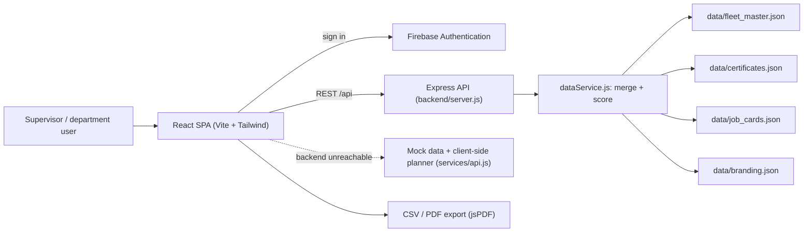

# Metro Induction Planner (KMRL)

A decision-support dashboard that helps Kochi Metro Rail (KMRL) depot supervisors decide each night which trainsets go into passenger service, which stay on standby and which go to maintenance.

## Overview

Every night a metro depot has to "induct" trainsets for the next day's service. The decision depends on several independent sources of information: fitness certificates, open maintenance job cards, cleaning status, advertiser branding commitments, mileage and stabling (bay) position. When this is done by hand across spreadsheets and departments, it is slow and error-prone.

The Metro Induction Planner brings those inputs into one web application. It merges the per-train data, scores each trainset's readiness with transparent rules, proposes a Service / Standby / Maintenance split with a reason for every train, and lets planners run what-if scenarios before committing. Department users (certificates, job cards, branding, cleaning and maintenance) each get their own view.

This is a **Smart India Hackathon (SIH)** prototype built around a KMRL train-induction problem statement. It runs on sample data for 25 trainsets (`KMRL-TS-01` to `KMRL-TS-25`) stored as JSON files.

## Key features

- **Fleet dashboard** with KPIs and charts (Recharts) built from the merged fleet data.
- **Multi-source data merge**: the backend joins four JSON sources (fleet master, fitness certificates, job cards, branding) into one record per train ([`backend/dataService.js`](backend/dataService.js)).
- **Six-factor availability check** per train: engine/mileage, cleaning, certificates, branding SLA, maintenance (job cards) and service interval, each rated good / warning / critical ([`6-FACTOR_MONITORING_SYSTEM.md`](6-FACTOR_MONITORING_SYSTEM.md)).
- **Rule-based readiness score (0-100)** and recommendation text per train; trains are only marked available when the certificate is active, no job card is open and the train is clean.
- **Induction plan generation**: Service / Standby / Maintenance assignment with per-train reasoning, exportable to CSV and PDF (jsPDF).
- **What-if simulation**: exclude trains, modify attributes or flag emergency maintenance, regenerate the plan and compare counts with the original ([`frontend/src/pages/Simulation.js`](frontend/src/pages/Simulation.js)).
- **Department pages**: fitness certificates, job card status, branding priorities, mileage/engine health, cleaning slots, stabling positions, cleaning and maintenance, plus a data-input page for editing records.
- **Role-based login** with Firebase Authentication; the user's email maps to a department role. Firestore security rules are included for role-scoped collections ([`firestore.rules`](firestore.rules)).
- **Dark / light theme** and a responsive sidebar layout.
- **Offline-friendly frontend**: if the backend is unreachable, the API layer falls back to built-in mock trains and a client-side planner so the UI still works for demos.

## Architecture



| Component | Role |
|---|---|
| Frontend ([`frontend/`](frontend)) | React 18 SPA with React Router. [`services/api.js`](frontend/src/services/api.js) wraps all backend calls, the mock fallback, the client-side planner and the CSV/PDF exports. [`contexts/AuthContext.js`](frontend/src/contexts/AuthContext.js) handles Firebase sign-in and role mapping. |
| Backend ([`backend/`](backend)) | Express API that reads the JSON data files on every request, merges them and computes scores, availability factors and recommendations. |
| Data ([`data/`](data)) | Sample datasets for 25 trainsets, one file per source system. |
| Firebase | Authentication for the department logins; Firestore rules and a setup script ([`setup-firestore.js`](setup-firestore.js)) for creating user and role documents. Hosting config in [`firebase.json`](firebase.json). |

## How it works

1. A user picks a department role on the login screen and signs in with Firebase email/password; the email determines the role and landing page.
2. The dashboard calls `GET /api/fleet`. The backend reads the four JSON files, joins them on `trainId` and, for every train, derives fitness status, cleaning status, priority, a readiness score, a recommendation and the six availability factors.
3. **Scoring** starts at 100 and deducts for an expired or soon-expiring certificate (-30 / -10), an open job card (-25), cleaning overdue (-15 after 7 days, -5 after 3), branding SLA below 95% (-10) and mileage above 100,000 km (-5), with a +5 bonus for SLA above 100%.
4. `POST /api/planning/generate` sorts trains by score (optionally filtered by fitness or job-card status) and returns the ranked plan with reasoning.
5. The planning page groups trains into Service, Standby and Maintenance. In the client-side planner, expired fitness always means Maintenance, high-scoring fit trains with closed job cards fill up to 14 service slots, and up to 4 go to standby.
6. In the simulation page, the planner changes the scenario (exclusions, modified attributes, emergency maintenance), regenerates the plan and compares it with the original.
7. Plans can be exported as CSV or PDF.

## Tech stack

| Layer | Technologies |
|---|---|
| Frontend | React 18, React Router 6, Vite, Tailwind CSS 3, Recharts, lucide-react, jsPDF + jspdf-autotable |
| Backend | Node.js, Express 4, cors, morgan, dotenv |
| Auth and hosting | Firebase Authentication, Cloud Firestore rules, Firebase Hosting config; Vercel configs for frontend and backend |
| Data | JSON files (sample data) |

## Project structure

```text
SIH/
├── backend/
│   ├── server.js                 # Express API: /api/health, /api/fleet, /api/planning/generate, ...
│   ├── dataService.js            # Merges JSON sources, scoring, six-factor availability
│   ├── scripts/generateCertificates.js  # Generates sample certificate data
│   └── vercel.json               # Vercel serverless config for the API
├── data/                         # fleet_master, certificates, job_cards, branding (JSON)
├── frontend/
│   ├── index.html                # Vite entry HTML
│   ├── vite.config.js            # Dev server on :3000, build output in build/
│   └── src/
│       ├── App.jsx               # Routes (dashboard, planning, simulation, department pages)
│       ├── pages/                # Dashboard, TrainPlanning, Simulation, DataInputs, department pages
│       ├── components/Sidebar.jsx # Role-aware navigation
│       ├── contexts/AuthContext.jsx # Firebase auth and role mapping
│       ├── services/api.js       # API client, mock fallback, client planner, exports
│       └── config/firebase.js    # Firebase web config
├── firebase.json, firestore.rules, firestore.indexes.json
├── setup-firestore.js            # Creates Firestore users/roles (needs a service account key)
├── test-data-ingestion.js        # Script that prints merged fleet data and statistics
├── start.bat, deploy.sh, deploy.bat
└── *.md                          # Feature notes, Firebase setup, deployment notes
```

## Getting started

### Prerequisites

- Node.js 20.19+ or 22.12+ and npm (required by Vite)
- A Firebase project with Email/Password authentication enabled (for logins)

### Installation

```bash
git clone https://github.com/suriyaprakash-25/SIH.git
cd SIH

cd backend && npm install
cd ../frontend && npm install
```

### Configuration

| Variable | Where | Purpose |
|---|---|---|
| `PORT` | backend | API port (default `5000`) |
| `VITE_API_URL` | frontend | Backend base URL including `/api` (default `http://localhost:5001/api`) |

Note that the defaults do not match: either start the backend with `PORT=5001` or set `VITE_API_URL=http://localhost:5000/api`. The backend's CORS allowlist only includes `http://localhost:3000` and `http://127.0.0.1:3000`.

The frontend was migrated from Create React App to Vite, so the variable formerly called `REACT_APP_API_URL` is now `VITE_API_URL` (read via `import.meta.env`). Vite inlines it at build time, so set it in `frontend/.env.local` or in your hosting provider before running `npm run build`.

The Firebase web config lives in [`frontend/src/config/firebase.js`](frontend/src/config/firebase.js); point it at your own Firebase project and create the department users there (see [FIREBASE_SETUP.md](FIREBASE_SETUP.md)). `setup-firestore.js` expects a service account key saved as `firebase-admin-key.json` in the repository root; that file must never be committed.

### Run

```bash
# Terminal 1: API
cd backend
npm run dev          # or: npm start

# Terminal 2: UI on http://localhost:3000
cd frontend
npm start            # or: npm run dev
```

Production build: `cd frontend && npm run build` writes static files to `frontend/build/` (the same folder Create React App used, so `vercel.json` and `firebase.json` are unchanged). `npm run preview` serves that build locally.

On Windows, [`start.bat`](start.bat) starts both (note that it first force-kills all running `node.exe` processes).

To check the data merge without the UI:

```bash
node test-data-ingestion.js
```

There is no automated test suite (the backend `npm test` script is a placeholder).

## API

| Method | Endpoint | Description |
|---|---|---|
| `GET` | `/api/health` | Service status |
| `GET` | `/api/fleet` | Merged fleet records with score, recommendation and six availability factors |
| `GET` | `/api/fleet/statistics` | Aggregate fleet statistics |
| `GET` | `/api/trains` | Legacy alias returning the merged fleet array |
| `POST` | `/api/planning/generate` | Ranked plan; body `{ "filters": { "fitnessStatus": "Valid", "jobCardStatus": "Closed" } }` (filters optional) |
| `PUT` / `DELETE` | `/api/trains/:id` | Acknowledge an update or delete (no persistence yet) |

Example merged record (abridged):

```json
{
  "trainId": "KMRL-TS-01",
  "mileage": 75000,
  "bayPosition": "STL-01",
  "fitnessStatus": "Valid",
  "cleaningStatus": "Clean",
  "jobCard": { "status": "Closed", "details": "..." },
  "branding": { "category": "Branded", "advertiser": "...", "slaCompliance": 100 },
  "priority": "Low",
  "score": 100,
  "isAvailableForService": true
}
```

## Limitations and roadmap

- **Prototype on sample data.** All train data comes from JSON files; there is no database, and `PUT`/`DELETE /api/trains/:id` do not persist anything.
- **Rule-based, not AI.** Scores and assignments use fixed thresholds; there is no optimisation solver or trained model yet. Two slightly different scoring rules exist (backend `dataService.js` and the client-side planner in `services/api.js`).
- **Demo authentication.** The login screen and [`firebase-web-setup.html`](firebase-web-setup.html) contain hardcoded demo accounts and passwords, and roles are derived from email addresses on the client.
- **Partial department backends.** The job card page calls `/api/jobcards` endpoints that the backend does not implement yet, so it always falls back to browser `localStorage`; other department pages work mainly from in-page sample data.
- Port defaults between frontend and backend differ (see Configuration).
- A Vercel deployment is recorded in [DEPLOYMENT_SUCCESS.md](DEPLOYMENT_SUCCESS.md); preview URLs of that kind may require Vercel access and are not guaranteed to be live.
- Natural next steps: persist data in Firestore or a database, move role checks to the server, add a constraint solver for stabling geometry and shunting, and add automated tests.

## Author

Built by [Suriyaprakash](https://github.com/suriyaprakash-25) for the Smart India Hackathon.
